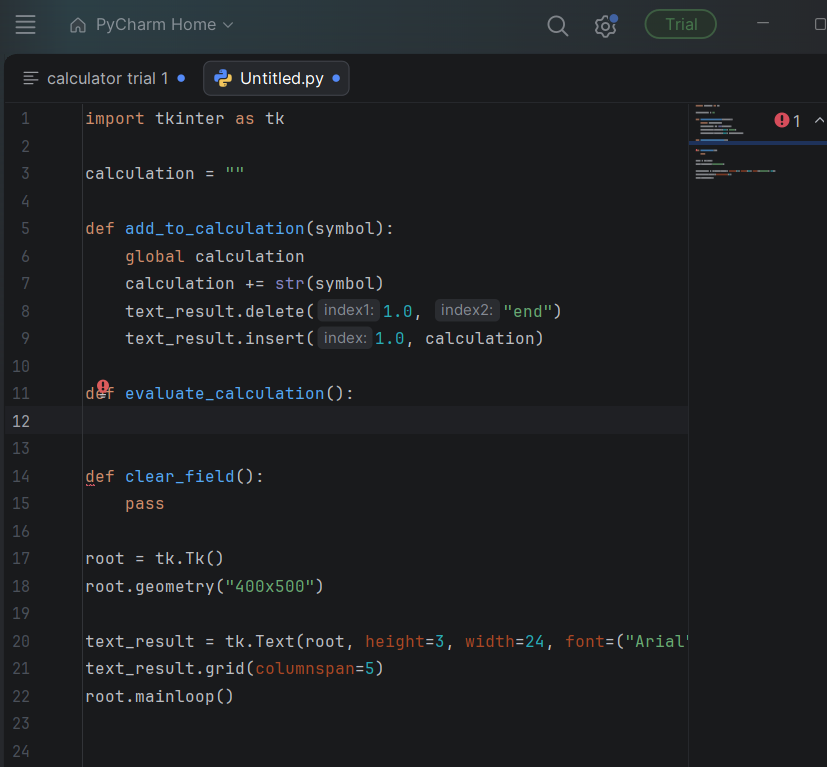
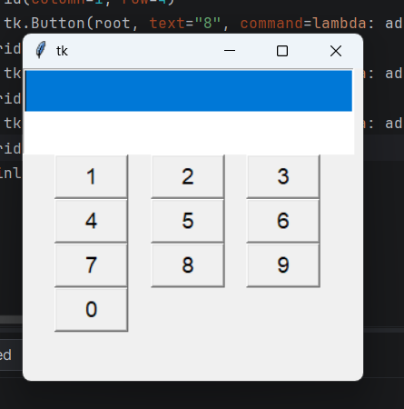
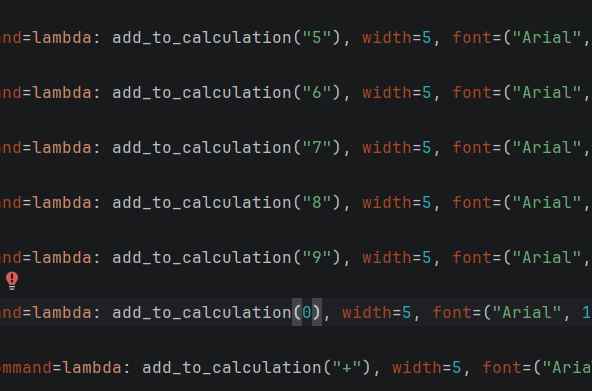
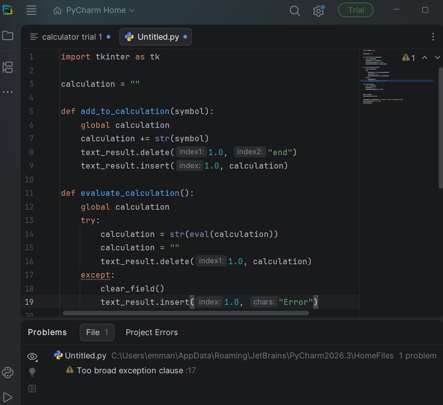

Python Calculator

A beginner Python programming project developed independently to build my understanding of programming fundamentals and software development.

Project Overview

This project is a calculator application developed using Python. It was created as part of my independent learning journey into software engineering, allowing me to apply programming concepts to a practical problem.
The calculator currently supports:

Addition, subtraction, multiplication, division, input validation, division by zero handling, error messages, exit option, user-friendly menu.

Technologies Used

Programming language: Python
Development environment: IDLE
Version control and project hosting:GitHub

How to Run the Programme

1. Download or clone this repository.
2. Ensure Python is installed on your computer.
3. Open the code file using Python IDLE or another Python editor.
4. Run the programme.

Development Process

I developed this project independently after a brief course on youtube, working through the process of writing, testing and improving my code.

Initial Development

I started writing the program because i was eager to implement my newly found knowledge in python coding into a real project. Although i used the eval functions, instead of going through each individual code for possible calculation route, my understanding of python coding has greatly increased.  

Testing and Debugging

i kept having a problem with conversion, like from float to string and vice versa. it was an easily fixable error. at some points my calculator was not giving evaluations to the calculation and that was because i kept the value added to the calculation as strings and not numbers.

Final Implementation

After testing and making improvements, I produced a working version of the calculator.

Key Learning Outcomes

Through this project, I developed my understanding of:
- Python programming fundamentals.
- Applying logical thinking to solve problems.
- Testing programme functionality.
- Identifying and correcting errors.
- Organising and documenting a software project.

Future Improvements

Potential improvements I would like to explore include:
- trigonometric functions.
- Improving input validation and error handling.
- Expanding the calculator's functionality

I would also like to be able to tackle this problem

Project Reflection

This project gave me an opportunity to move beyond theoretical learning and apply Python to a practical application. It also helped me understand the importance of testing, debugging and continuously improving software.

As I continue learning software engineering, I intend to build on these foundations through more advanced programming projects.
